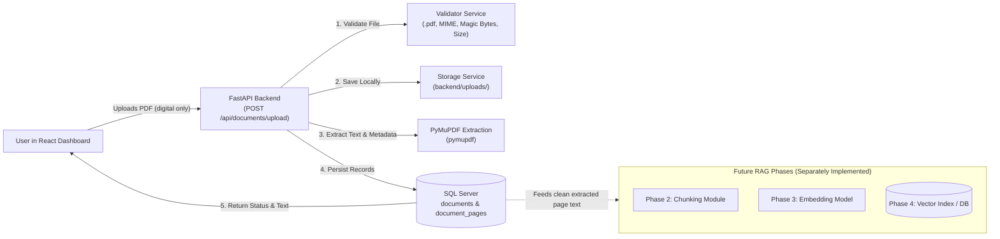

# Beginner-Friendly RAG Document Processing Application

A clean, modular **Document Ingestion** application designed as **Phase 1** of a complete Retrieval-Augmented Generation (RAG) system.

---

## 🛠️ Technology Stack
- **Frontend**: React 19 + Vite (Modern, responsive UI with Lucide icons)
- **Backend**: Python 3 + FastAPI (Modular service architecture, Swagger docs, CORS configured)
- **PDF Extraction**: PyMuPDF (`pymupdf`) for high-fidelity digital text and metadata extraction
- **Database**: Microsoft SQL Server (via SQLAlchemy ORM & `pyodbc` driver)

---

## 📌 Scope & Architecture Notice
> [!IMPORTANT]
> **Scope for this phase:** Document ingestion only (PDF upload, validation, local storage, text extraction, SQL Server persistence, and dashboard inspection).
> 
> As instructed, **Chunking**, **Embeddings**, and **Vector Storage** are **NOT** executed automatically here. The database schema and service layers are designed to feed directly into Phase 2 (Chunking) and Phase 3 (Embeddings) when you are ready to implement them.



---

## ✨ Features Implemented

### 🖥️ Frontend (React + Vite)
1. **Document Upload Dashboard**: Clean, modern dark-themed user interface with drag-and-drop & file browser.
2. **Digital PDF Restriction**: Frontend validates `.pdf` extension, `application/pdf` MIME type, non-empty files, and size limits before sending.
3. **Upload & Processing Status**: Live 4-stage pipeline visualization showing validation, local file storage, PyMuPDF text extraction, and SQL Server persistence.
4. **Document Ingestion List**: Live table displaying all uploaded documents, original filenames, file sizes, page counts, extracted word counts, and status badges.
5. **Extracted Information Inspector (Modal)**:
   - Document metadata (Total Pages, Words, Characters, PDF Title, Author, Stored filename).
   - Page-by-page text selector tabs (`Page 1`, `Page 2`, ...).
   - One-click copy text functionality.
   - Future RAG preparation notes explaining how downstream chunking will consume the page text.
6. **Backend Health & SQL Server Connection Indicator**: Live pill in header showing database status.

### ⚙️ Backend (Python + FastAPI)
1. **Modular Architecture**:
   - `config.py`: Pydantic settings loading from `.env`.
   - `database.py`: SQLAlchemy connection pool & session dependency.
   - `services/`: Business logic decoupled from route handlers:
     - `file_validator.py`: Strict checks for extension, MIME type, `%PDF-` signature magic bytes, and file size.
     - `file_storage.py`: Safe streaming of file to `uploads/` with UUID prefixes to avoid collisions.
     - `pdf_extractor.py`: Extracts page-by-page clean digital text and PDF metadata using PyMuPDF.
     - `document_service.py`: Orchestrates ingestion steps and commits records to SQL Server.
   - `models/`: SQLAlchemy ORM models (`Document` and `DocumentPage`).
   - `schemas/`: Pydantic validation schemas.
   - `api/routes.py`: Clean REST endpoints (`POST /api/documents/upload`, `GET /api/documents`, `GET /api/documents/{id}`, `DELETE /api/documents/{id}`).
2. **Swagger UI**: Interactive API documentation at `http://127.0.0.1:8000/docs`.
3. **CORS Configured**: Pre-configured for React Vite (`http://localhost:5173`).
4. **SQL Server Tables**:
   - `documents`: Stores document ID, filenames, size, status (`PROCESSING`, `COMPLETED`, `FAILED`), page count, word count, metadata, timestamps.
   - `document_pages`: Stores page number, word count, character count, and raw clean extracted text.

---

## 🚀 How to Run the Application

### Prerequisites
- Python 3.10+
- Node.js 18+
- SQL Server (or LocalDB `(localdb)\MSSQLLocalDB` which is standard on Windows with Visual Studio / SSMS)

---

### Step 1: Start the Backend (FastAPI)

1. Open a terminal in the project root:
```powershell
cd backend
```

2. Activate the virtual environment:
```powershell
.\venv\Scripts\Activate.ps1
```

3. Ensure dependencies are installed (already installed during setup):
```powershell
pip install -r requirements.txt
```

4. Verify database settings in `backend/.env`:
```env
DATABASE_URL="mssql+pyodbc://@(localdb)\MSSQLLocalDB/RAGDocs?driver=ODBC+Driver+17+for+SQL+Server&trusted_connection=yes"
```
*(Tables `documents` and `document_pages` are created automatically on startup).*

5. Start the FastAPI server:
```powershell
uvicorn app.main:app --reload --host 127.0.0.1 --port 8000
```

6. Verify Backend:
- API Home: [http://127.0.0.1:8000/](http://127.0.0.1:8000/)
- Swagger Documentation: [http://127.0.0.1:8000/docs](http://127.0.0.1:8000/docs)
- Health Check: [http://127.0.0.1:8000/api/health](http://127.0.0.1:8000/api/health)

---

### Step 2: Start the Frontend (React + Vite)

1. Open a new terminal in the project root:
```powershell
cd frontend
```

2. Start the Vite development server:
```powershell
npm run dev
```

3. Open your browser at:
**[http://localhost:5173](http://localhost:5173)**

---

## 🧪 Testing the Ingestion with Sample Data

A sample PDF generator is included:
```powershell
cd backend
.\venv\Scripts\python.exe create_sample_pdf.py
```
This generates `backend/sample_rag_intro.pdf` with digital text and metadata. You can upload this file directly in the React dashboard to see the full ingestion pipeline in action!

---

## 🔮 Roadmap: Next Steps in your RAG Journey
When you are ready to build the next phases, here is where each will hook into this project:

1. **Phase 2: Text Chunking**
   - Query `document_pages` by `document_id`.
   - Implement fixed-size or semantic recursive chunking (e.g. 500 tokens with 50 token overlap).
   - Create a `document_chunks` table in SQL Server referencing `document_pages.id`.

2. **Phase 3: Vector Embeddings**
   - Send each chunk to an embedding model (e.g., HuggingFace `sentence-transformers` or OpenAI `text-embedding-3-small`).
   - Obtain vector embedding arrays (e.g., 384 or 1536 floating point numbers).

3. **Phase 4: Vector Storage & Retrieval**
   - Store vector embeddings in SQL Server (or ChromaDB / FAISS / Qdrant).
   - Implement cosine similarity search to retrieve relevant chunks for user queries.

